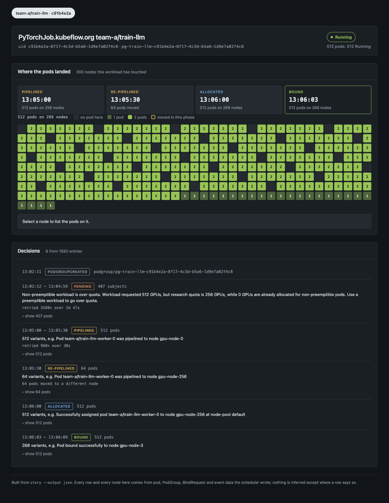
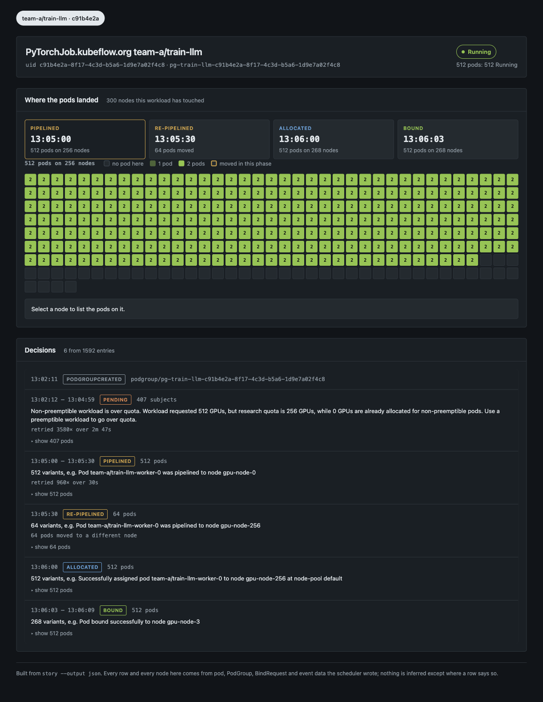
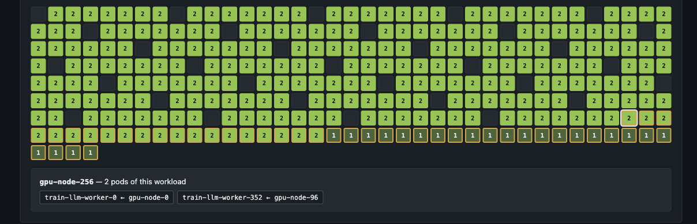
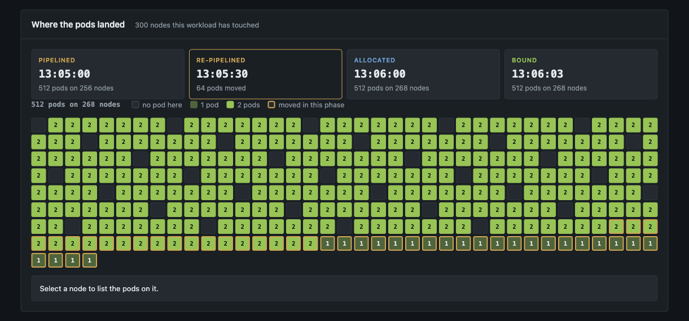
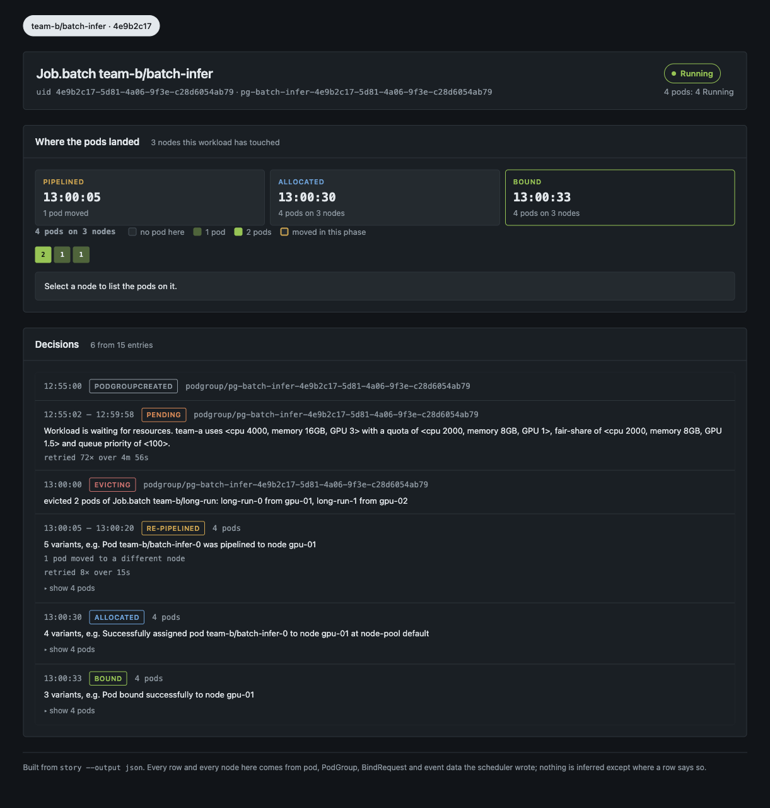

# Scheduling Story

`story` answers one question: **why is this workload where it is?**

It joins everything KAI records about a workload — pod and PodGroup status, the events the scheduler,
binder and podgrouper emitted, BindRequests, and the ownership chain back to the Job or PyTorchJob
you submitted — into one timeline of decisions, in the terminal or in a browser.

```
Job.batch team-b/batch-infer (uid 4e9b2c17)
  PodGroup pg-batch-infer-4e9b2c17-5d81-4a06-9f3e-c28d6054ab79 (uid b7d31e68)

STATE  Running (4 pods: 4 Running)

TIME      SUBJECT                     DECISION         DETAIL
09:55:00  podgroup/pg-batch-infer-…   PodGroupCreated
09:55:02  podgroup/pg-batch-infer-…   Pending          Workload is waiting for resources. team-a uses <cpu 4000, memory 16GB, GPU 3> with a quota of <cpu 2000, memory 8GB, GPU 1>… [x72 until 09:59:58]
10:00:00  podgroup/pg-batch-infer-…   Evicting         reclaim: evicted 2 pods of Job.batch team-b/long-run: long-run-0 from gpu-01, long-run-1 from gpu-02
10:00:05  pod/batch-infer-0           Pipelined        Pod team-b/batch-infer-0 was pipelined to node gpu-01 [x2 until 10:00:20]
10:00:20  pod/batch-infer-3           Pipelined        Pod team-b/batch-infer-3 was pipelined to node gpu-03
10:00:30  pod/batch-infer-0           Allocated        node gpu-01, Successfully assigned pod team-b/batch-infer-0 to node gpu-01 at node-pool default
10:00:33  pod/batch-infer-0 +1 more   Bound            Pod bound successfully to node gpu-01
```

## Building

```bash
go build -o bin/story ./cmd/story
```

## Usage

```
story [flags] <workload-name>
```

The name is the workload you submitted — the Job, PyTorchJob, Deployment or bare pod — not the
PodGroup. `story` finds the PodGroup from the podgrouper's `kai.scheduler/top-owner-metadata`
annotation, and everything else from there.

**Flags come before the name.** Go's flag parser stops at the first argument that is not a flag, so
`story my-job -output json` silently ignores the `-output`. Write `story -output json my-job`.

| Flag | Default | What it does |
|---|---|---|
| `--namespace`, `-n` | all namespaces | Namespace of the workload. |
| `--uid` | — | UID, or a unique prefix of one, to pick between same-named workloads. |
| `--output` | `text` | `text` or `json`. |
| `--serve` | off | Serve the story as a web page instead of printing it. |
| `--addr` | `localhost:8080` | Address `--serve` listens on. Loopback only unless you change it. |
| `--kubeconfig` | standard lookup | Path to the kubeconfig. |
| `--from-file` | — | Read a snapshot file instead of the cluster. |
| `--from-snapshots` | — | Read a chain of snapshot files, newest last. |

With no `--from-*` flag, `story` reads the live cluster through your kubeconfig. It only reads:
pods, PodGroups, BindRequests and events.

### Picking between workloads with the same name

Names are reused; UIDs are not. When more than one workload matches, `story` lists them and asks
rather than guessing, and exits 2 so a script can tell:

```
$ story --from-file pkg/story/testdata/train-llm.json train-llm
Found 2 workloads matching the name:
  #  NAMESPACE  KIND                     NAME       UID       CREATED              STATE
  1  team-a     PyTorchJob.kubeflow.org  train-llm  c91b4e2a  2026-10-20 10:02:11  live
  2  team-a     unknown-kind             train-llm  7f3a19c2  2026-10-20 09:12:30  deleted (from events)

re-run with --namespace or --uid to pick one
```

A deleted workload is still tellable while its events live — about an hour, by Kubernetes' default
event TTL. Pick one with `--uid 7f3a19c2`, or answer the prompt when stdin is a terminal.

### Decisions

| Decision | Where it comes from |
|---|---|
| `PodGroupCreated` | The PodGroup's creation timestamp. |
| `GroupingFailed` | A `PodGrouperWarning` event. Suppressed for pods that have no owner, where the podgrouper's complaint is routine. |
| `Pending` | An `Unschedulable` event — the message says what the workload is waiting for. |
| `NotReady`, `Stale` | `NotReady` and `StaleJob` events. |
| `Evicting` | An `Evict` event that names **this** workload as the evictor. The detail names the victims and the nodes they were taken from. |
| `Pipelined` | A `Pipelined` event: the scheduler has reserved a node but cannot bind yet. |
| `Allocated` | A `Scheduled` event, folded together with the BindRequest it produced. |
| `Bound` / `BindFailed` | The binder's `Bound` and `BindingError` events. |
| `Evicted` | An `Evict` event on this workload, naming who evicted it and under which action. |

Runs of the same decision are collapsed with a repeat count (`[x212 until 10:04:58]`), and pods that
got the same decision on the same node at the same moment are collapsed into one row
(`pod/batch-infer-0 +1 more`).

### JSON

`--output json` emits the whole story, including fields the text view summarises:

```json
{
  "time": "2026-10-20T13:00:00+03:00",
  "count": 1,
  "subjects": [{ "kind": "PodGroup", "namespace": "team-b", "name": "pg-batch-infer-…" }],
  "decision": "Evicting",
  "message": "evicted 2 pods of Job.batch team-b/long-run: long-run-0 from gpu-01, long-run-1 from gpu-02",
  "action": "reclaim",
  "victims": [
    { "kind": "Pod", "namespace": "team-b", "name": "long-run-0", "node": "gpu-01" },
    { "kind": "Pod", "namespace": "team-b", "name": "long-run-1", "node": "gpu-02" }
  ]
}
```

This is the same shape the web UI consumes, so anything you can see there you can script against.

## The web UI

```bash
story --serve -n team-a train-llm
```

```
story for "train-llm" on http://127.0.0.1:8080
reading the cluster every 2s while the page is open
```

The page is self-contained: no font, script or style is fetched from the network, so it works on an
air-gapped jump host. It binds loopback only unless you pass `--addr`.

### Reading a large workload

A 512-pod gang on a 300-node cluster prints **1,598 lines** of text. The same story in the browser is
six rows, because entries of the same decision within a few seconds of each other are one wave of the
scheduler's loop:



Nothing is discarded — the grouping happens in the page, over the full JSON, and every row expands to
the pods behind it.

> The screenshots on this page come from a synthetic 512-pod, 300-node fixture, not from a fixture
> in this repository: at 5.7MB it is too large to carry here.

### Where the pods landed

The grid is every node the workload touched, one cell each, shaded by how many of its pods are on
that node. The rail above it steps through the moments the placement changed:



Click a cell to list the pods on that node. A pod that arrived there from somewhere else shows where
it came from — below, both of `gpu-node-256`'s pods were moved onto it, from `gpu-node-0` and
`gpu-node-96`:



### Watching a re-pipeline

This is where the UI earns itself. Between two pipelining waves the scheduler moved 64 of the 512
pods onto different nodes. Selecting the second wave rings every cell that gained one, so the
migration reads as a shape rather than a diff:



Below the map, a **Pods that changed node** panel lists all 64 moves grouped by route
(`gpu-node-0 → gpu-node-256`, and so on), with the pods that took each one.

### A reclaim, from the reclaimer's side

The `Evicting` decision is the workload's own account of what it took and from whom:



### Live updates

When `story --serve` is reading a cluster, the page re-reads it every two seconds and redraws only
what changed, keeping the phase and node you have selected. Pages built from files do not poll —
the files cannot change underneath you.

## Working without a cluster

Events expire after about an hour and a deleted workload takes its objects with it, so the state you
need to explain is often already gone. Two file-based sources cover that.

### A story snapshot

`story` can read the same JSON it emits internally — pods, PodGroups, BindRequests and events in one
file. The fixtures under [`pkg/story/testdata`](../../pkg/story/testdata) are in this format:

```bash
story --from-file pkg/story/testdata/reclaim-repipeline.json -n team-b batch-infer
story --serve --from-file pkg/story/testdata/reclaim-repipeline.json -n team-b batch-infer
```

### A scheduler snapshot

A snapshot captured from a running scheduler ([`docs/plugins/snapshot.md`](../plugins/snapshot.md))
holds the objects but **no events** — and the events are where the decisions are. Replaying the
snapshot through the real scheduler recovers them.

## Turning one snapshot into a chain

This is the part worth understanding. One snapshot and one events file do not agree with each other:
the objects are frozen at capture time while the events come from a replay that happened afterwards,
so a preempted workload still reads `Running` above a timeline that ends in `Evicted`.

`--create-decision-snapshots` fixes that by capturing the state **between** cycles, so each set of
events sits next to the state it produced:

```bash
# capture from the running scheduler
kubectl port-forward -n kai-scheduler deployment/kai-scheduler-default 8081 &
curl -sSf "localhost:8081/get-snapshot" -o a.snapshot.zip

# replay it and record every step
go build -o bin/snapshot-tool ./cmd/snapshot-tool
./bin/snapshot-tool --filename a.snapshot.zip --cycles 3 --create-decision-snapshots
```

```
a.snapshot.zip     your capture, untouched
a.1.snapshot.zip   the state the replay started from   (no events: nothing produced it)
a.2.snapshot.zip   a.2.events.zip    the decisions of cycle 1, and the state they produced
a.3.snapshot.zip   a.3.events.zip    cycle 2
a.4.snapshot.zip   a.4.events.zip    cycle 3
```

Three cycles produce four states, since the first is the starting point. More than one cycle is
needed to see a preemption through: one cycle evicts the victims and frees the node, a later one
allocates it — exactly as the scheduler's own loop does.

Then read the chain, newest last:

```bash
story --from-snapshots a.1.snapshot.zip,a.2.snapshot.zip,a.3.snapshot.zip,a.4.snapshot.zip \
      -n team-a high-prio
```

The files can also be given as bare arguments, which is what a list typed with spaces after the
commas arrives as:

```bash
story -n team-a high-prio a.1.snapshot.zip a.2.snapshot.zip a.3.snapshot.zip a.4.snapshot.zip
```

Now both halves agree:

```
STATE  Evicted since 2026-10-21 16:55:11 (no pods)
WHY    Pod team-a/low-prio-0 was preempted by higher priority workload team-a/pg-high-prio-…

TIME      SUBJECT                       DECISION         DETAIL
15:38:26  podgroup/pg-low-prio-…        PodGroupCreated
16:55:11  podgroup/pg-low-prio-…        Evicted          Pod team-a/low-prio-0 was preempted by higher priority workload…, by Job team-a/high-prio (uid d47e5a90), action preempt

note: state is as of a.4.snapshot.zip; objects missing from it are shown as deleted
```

### What the chain does with objects

Objects are taken from the newest snapshot that holds them. One that disappears along the way — a
preempted pod — is **kept**, so the story can still name it and the node it was taken from, but is
marked deleted so it no longer counts towards the workload's state. That is why the eviction above
can say `from gpu-node-1` even though the pod is long gone.

A snapshot with no events file is still read for its objects, and the story says what is missing,
in the terminal and in the UI:

```
note: a.3.snapshot.zip has no a.3.events.zip: the decisions that led to that state are missing from this story
```

### What a replay cannot tell you

- **Timestamps are replay time, not cluster time.** Intervals between decisions are meaningful;
  absolute times are not.
- **A replay is what the scheduler *would* do**, from the state in the snapshot, with the scheduler
  binary you built. It is not a recording of what it did.
- **A single snapshot with `--dump-events`** (no `--create-decision-snapshots`) gives you one
  mismatched pair; the story carries a note saying so.

## Exit codes

| Code | Meaning |
|---|---|
| 0 | Story printed, or the server exited cleanly. |
| 1 | Error: no such workload, unreadable file, no cluster. |
| 2 | The name matched more than one workload; the candidates were listed. |

## Cost on a large cluster

`story` lists pods, PodGroups, BindRequests and events, cluster-wide when `--namespace` is empty.
Measured on a synthetic 15,512-pod, 300-node cluster with a 512-pod gang: **0.21s, 131MB resident**.
Always pass `-n` when you know the namespace — it is the difference between reading one namespace and
reading the whole cluster, and `--serve` against a live cluster repeats that read every two seconds.
